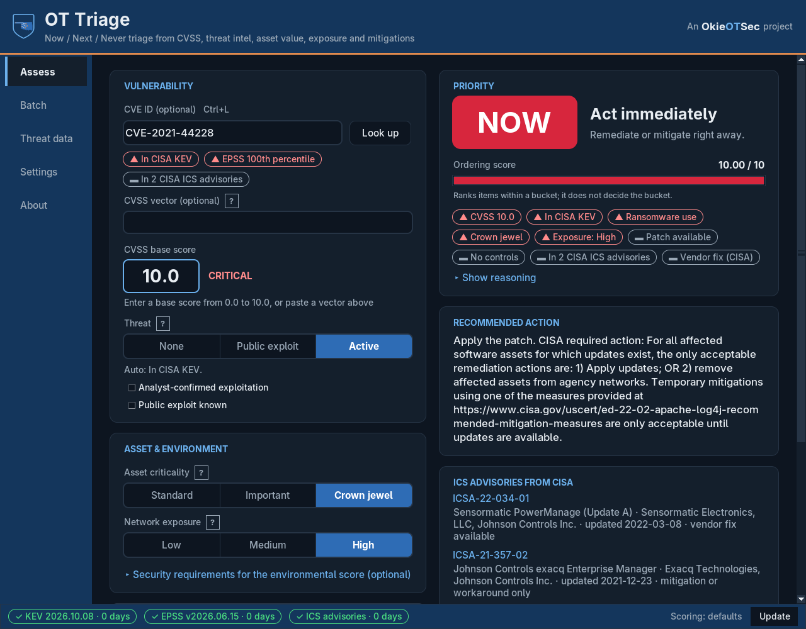
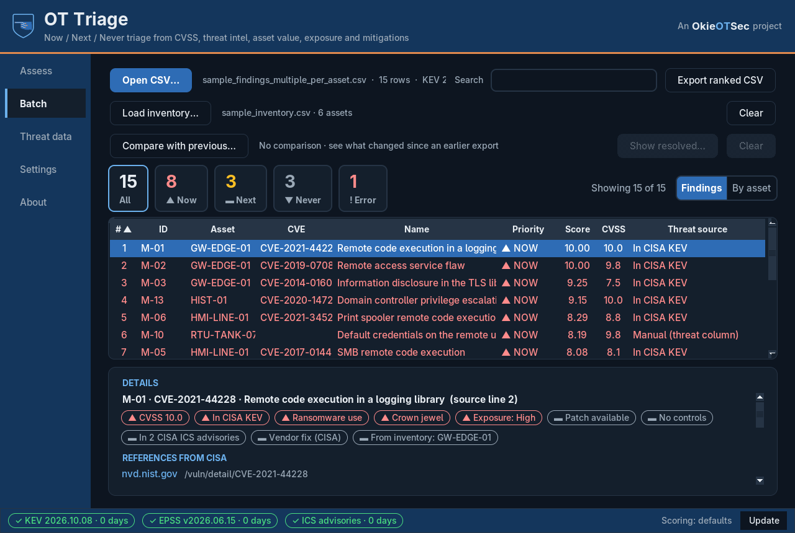
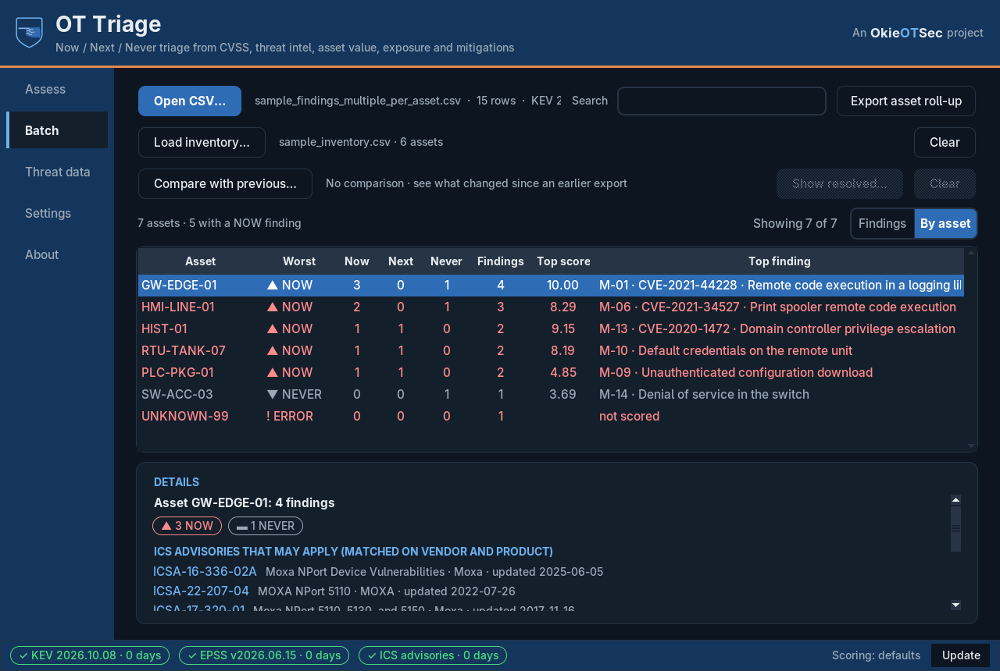
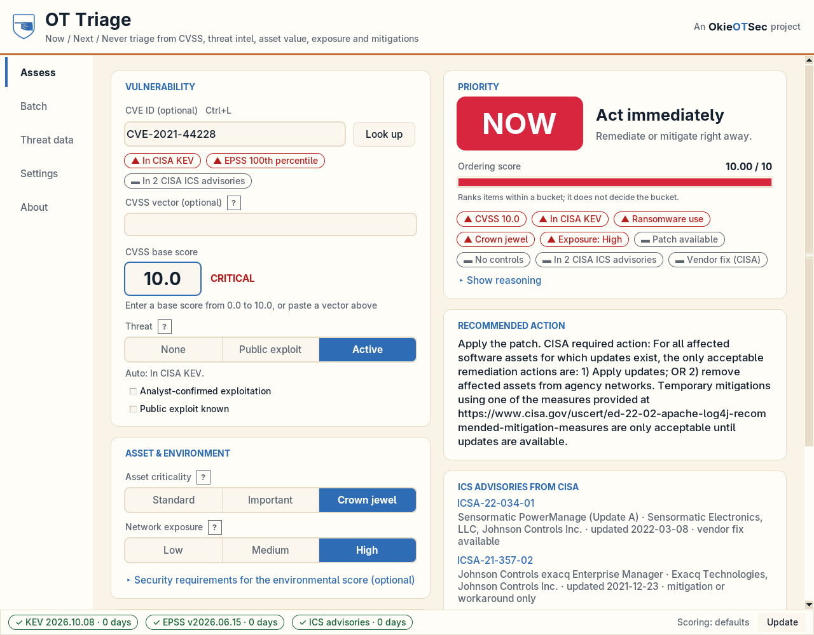
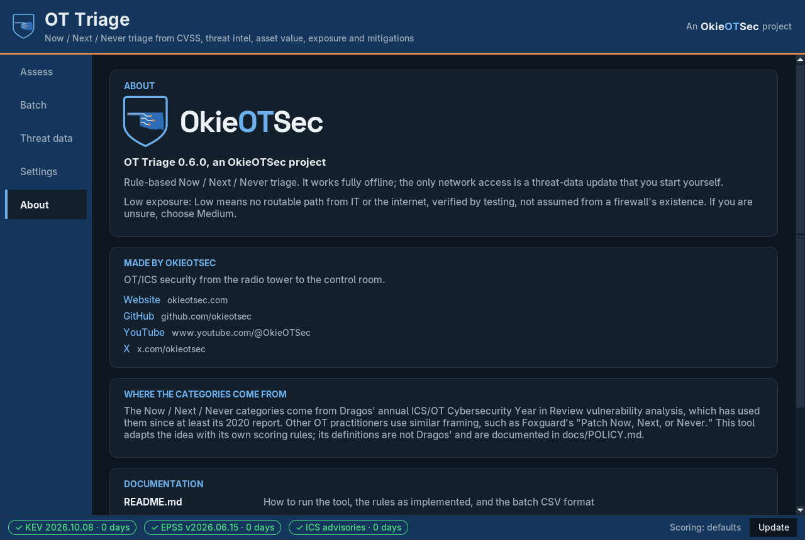
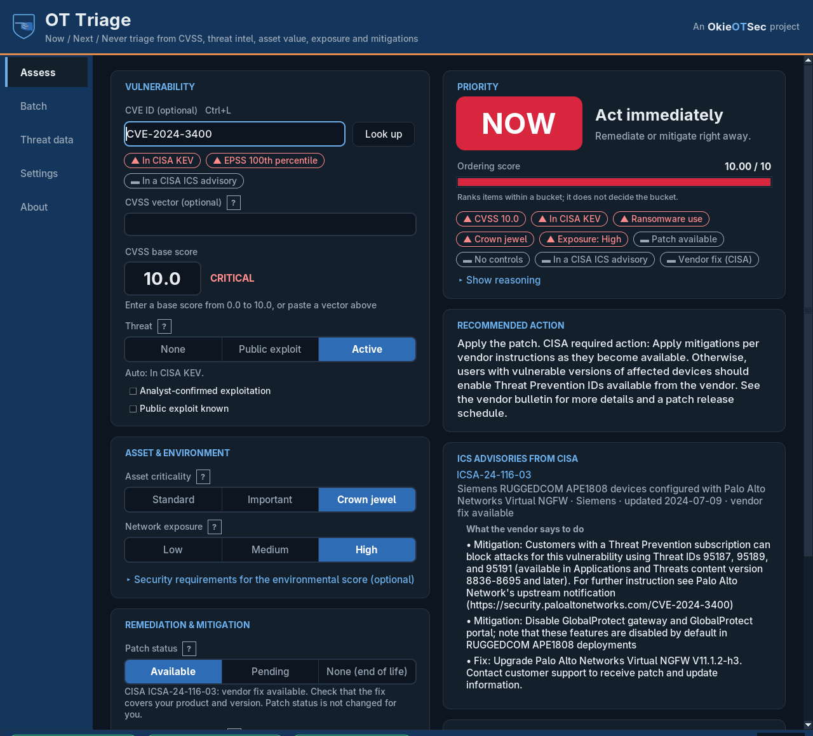

<p align="center">
  <picture>
    <source media="(prefers-color-scheme: dark)" srcset="assets/brand/readme/okieotsec-lockup-dark-1200.png">
    
  </picture>
</p>

# OT Triage

*OT Triage, an [OkieOTSec](https://okieotsec.com) project.*

[](https://github.com/okieotsec/ot-triage/actions/workflows/ci.yml)
[](LICENSE)

**Now / Next / Never triage for OT/ICS vulnerabilities**, by [OkieOTSec](https://okieotsec.com).

Give it a CVSS score or vector, a CVE, how critical and how exposed the asset is, and what protections exist. It
answers **NOW**, **NEXT** or **NEVER**, shows *why* in plain language, and shows what single change would move the
answer. It pulls in CISA's Known Exploited Vulnerabilities (KEV) catalog and EPSS scores, including CISA's own
advisory links, shows which CISA ICS advisories name a CVE, and ranks whole spreadsheets of findings in one go.



Pure standard library: no third-party dependencies. It works fully offline; the only network access is a
threat-data update that you start yourself.

<table>
  <tr>
    <td width="50%"></td>
    <td width="50%"></td>
  </tr>
  <tr>
    <td align="center"><em>Batch: rank a whole CSV, filter by bucket, see the references behind a row</em></td>
    <td align="center"><em>By asset: the worst thing on each asset, and what to handle on one visit</em></td>
  </tr>
  <tr>
    <td width="50%"></td>
    <td width="50%"></td>
  </tr>
  <tr>
    <td align="center"><em>A light theme, a text-size setting, and keyboard shortcuts throughout</em></td>
    <td align="center"><em>An OkieOTSec project</em></td>
  </tr>
  <tr>
    <td colspan="2"></td>
  </tr>
  <tr>
    <td colspan="2" align="center"><em>CISA's ICS advisory for the CVE, with what the vendor says to do about it (here: CVE-2024-3400, from the advisory for a Siemens RUGGEDCOM device)</em></td>
  </tr>
</table>

## Run

```
python3 ot_triage_gui.py            # the app (Python 3.12 or newer, with Tkinter)
python3 ot_triage_cli.py findings.csv -o ranked.csv    # the same ranking on the command line (docs/CLI.md)
python3 ot_triage_import.py scan.csv -o findings.csv   # findings and an inventory from a Nessus, Tenable or OpenVAS export (docs/IMPORT.md)
python3 tools/headless_tests.py     # the tests, on an invisible display (no windows open on your screen)
python3 -m unittest                 # the tests, the plain way (GUI tests open real windows)
```

The tests that need a display skip themselves when none is available. `pip install hypothesis` adds the optional
property-based tests.

## Download and run

Each [release](https://github.com/okieotsec/ot-triage/releases) has a portable bundle, `ot-triage-<version>.zip`, with a `.sha256` file next to it. Unzip it anywhere and, on Windows, double-click **OT Triage.pyw**; everywhere else run `python3 ot_triage_gui.py`. You need Python 3.12 or newer with Tkinter (the installer from python.org includes it). There is nothing to install: no third-party packages, no executable that could be mistaken for malware, and the bundle is reproducible, so anyone can rebuild it from the tag with `python3 tools/make_bundle.py` and compare the checksum. See [docs/RELEASING.md](docs/RELEASING.md).

## Using the GUI

| View | What it does |
| --- | --- |
| **Assess** | Score one vulnerability. Optionally look up a CVE in the local KEV, EPSS and CISA ICS advisory data to fill in the threat level. Shows the bucket, why-chips, the recommended action, the reference links CISA lists for a KEV entry, the ICS advisories that name the CVE with what each vendor says to do about it, and what single change would move the result. |
| **Batch** | Score a CSV file. Click a bucket counter to filter, search, sort by any column, and export the ranked results. **By asset** groups the findings by `asset_id`: the worst bucket on each asset, how many NOW, NEXT and NEVER findings it has, and what could be handled on one outage window. **Compare with previous…** reads an earlier ranked export and shows what is new, what moved up or down and what was resolved since. |
| **Threat data** | See how fresh the KEV, EPSS and ICS advisory data is. Update it (after a confirmation) or import files for offline use. |
| **Settings** | Change the four scoring settings with live validation, and choose the theme and text size. |
| **About** | Version, the exposure definition, where the categories come from, and the documentation. |

The status bar always shows how fresh the KEV, EPSS and ICS advisory data is, and a **Custom scoring** badge appears whenever the
scoring settings differ from the defaults.

| Shortcut | Action |
| --- | --- |
| Ctrl+1 to Ctrl+5 | Switch views (Assess, Batch, Threat data, Settings, About) |
| Ctrl+L | Go to the CVE field |
| Ctrl+Shift+C | Copy the summary of the current result |
| Ctrl+plus / Ctrl+minus / Ctrl+0 | Make the text larger or smaller, or reset it (also in Settings) |
| Arrow keys | Change the choice in a focused segmented control |

See [docs/GUI_TESTING.md](docs/GUI_TESTING.md) for how the GUI is tested.

## Inputs

| Input | Values |
| --- | --- |
| CVSS base score | 0.0 to 10.0, typed or worked out from a pasted CVSS 3.0, 3.1 or 4.0 vector (see [docs/CVSS.md](docs/CVSS.md)) |
| Threat | Active exploitation in the wild, public exploit available, no known exploitation |
| Asset | Crown jewel, important, standard |
| Exposure | High (internet connected), medium, low |
| Patch | Available, pending (vendor supported), none ever (end of life) |
| Controls | None, partial, strong |

"Reachable" below means exposure is high or medium.

## Rules as implemented

For the reasoning behind each rule, see [docs/POLICY.md](docs/POLICY.md).

1. **Base bucket from threat**
   - Active exploitation: NOW if reachable or the asset is a crown jewel, otherwise NEXT.
   - Public exploit: NOW if exposure is high and CVSS >= 7.0, otherwise NEXT.
   - No known exploitation: NOW if CVSS >= 9.0 on a high-exposure crown jewel; NEXT if CVSS >= 7.0 and the item is reachable or not a standard asset; otherwise NEVER.
2. **Low severity cap**: an item with CVSS below 4.0 is capped at NEXT, except an actively exploited, high-exposure crown jewel, which stays at NOW.
3. **Patch available**: strong controls lower the bucket one level, but never below NEXT for actively exploited items.
4. **No patch (pending or end of life)**: with CVSS of 4.0 or more, the bucket is raised one level unless strong controls are in place. Strong controls withhold the raise but earn no additional downgrade. End-of-life items with CVSS of 7.0 or more are floored at NEXT, since they need a replacement plan.
5. **Exposed crown jewel floor**: a crown jewel with high exposure and CVSS of 4.0 or more is never below NEXT.
6. **Controls and ranking**: partial controls never change the bucket and lower the ordering score by 0.5; strong controls lower it by 1.0 (and can also lower the bucket, see rule 3).

The **ordering score** (0 to 10) only ranks items within a bucket; it never decides the bucket.

Two CVSS lines in these rules (7.0 and 9.0) can be adjusted within limits; see [docs/SETTINGS.md](docs/SETTINGS.md). Values shown above are the defaults.

**Low exposure** means no routable path from IT or the internet, verified by testing, not assumed from a firewall's existence.

## Batch CSV

Required columns: `cvss` (or `cvss_vector`), `asset`, `exposure`, and `threat` (or `cve`). A `cvss_vector` column (CVSS 3.0, 3.1 or 4.0) supplies the score, and if it sets environmental metrics the environmental score is shown next to it for comparison (the priority uses the base score); see [docs/CVSS.md](docs/CVSS.md).
Optional columns: `id`, `name`, `patch` (default available), `controls` (default none).
An optional `asset_id` column links a row to an **asset inventory** (a second CSV, loaded with **Load inventory...**) that fills in `asset`, `exposure` and `controls` (and optionally the CVSS security requirements), so those columns can be left out; see [docs/INVENTORY.md](docs/INVENTORY.md).
An optional `cve` column looks the CVE up in local KEV, EPSS and ICS advisory data (see [docs/THREAT_DATA.md](docs/THREAT_DATA.md)); with it, `threat` can be left blank.
Other columns are ignored. Header names accept common aliases, and enum cells accept short aliases or the full dropdown labels.

Import limits: 25 MB and 50,000 data rows. Files with duplicate columns are rejected. Exported CSVs prefix text cells that start with `=`, `+`, `-`, `@`, tab or carriage return with `'` so spreadsheets do not run them as formulas.

## Documentation

- [docs/POLICY.md](docs/POLICY.md): the prioritization decisions and why
- [docs/CVSS.md](docs/CVSS.md): pasting CVSS vectors, supported versions and how the scores were verified
- [docs/THREAT_DATA.md](docs/THREAT_DATA.md): KEV, EPSS and ICS advisory data, offline updates and safety checks
- [docs/CLI.md](docs/CLI.md): the command line, for scripts and scheduled jobs
- [docs/IMPORT.md](docs/IMPORT.md): importing Nessus, Tenable and OpenVAS exports into findings and an inventory
- [docs/INVENTORY.md](docs/INVENTORY.md): the asset inventory, which fills in asset criticality, exposure and controls, the per-asset view and comparing with a previous export
- [docs/SETTINGS.md](docs/SETTINGS.md): adjustable settings, defaults, limits and file handling
- [docs/GUI_PROPOSAL.md](docs/GUI_PROPOSAL.md): proposed GUI refresh (open [docs/gui-mockup.html](docs/gui-mockup.html) in a browser)
- [docs/ROADMAP.md](docs/ROADMAP.md): planned work, order and design decisions

## Security

- **[SECURITY.md](SECURITY.md)** explains how to report a vulnerability, which three public files the app can download (and that it works fully offline otherwise), and what it reads and writes.
- **[SECURITY_TEST_PLAN.md](SECURITY_TEST_PLAN.md)** is the test plan. Each checkpoint's evidence is archived in `reports/`.
- **Software bill of materials:** [sbom/sbom.cdx.json](sbom/sbom.cdx.json) (CycloneDX). The application uses only the Python standard library, so the SBOM lists the application itself and no third-party components. It is generated from a brand-new empty environment by `tools/make_sbom.py`, and a test fails if it goes out of date.
- **Third-party material:** the CVSS 4.0 scoring tables come from FIRST's calculator (BSD-2-Clause); see [THIRD_PARTY_NOTICES.md](THIRD_PARTY_NOTICES.md).

### What was tested

| Checkpoint | Focus | Reports |
| --- | --- | --- |
| CP0 | Baseline before changes | [reports/cp0](reports/cp0/claude.md) |
| CP1 | CSV import and export, input validation | [reports/cp1](reports/cp1/claude.md) |
| CP2 | Network downloads and file parsing (the highest-risk area) | [reports/cp2](reports/cp2/claude.md) |
| CP3 | Settings files, the new GUI, background work; later the CVSS vector parser | [reports/cp3](reports/cp3/claude.md), [CVSS addendum](reports/cp3/claude-addendum-cvss.md) |
| CP4 | Release candidate: full regression and release gate | [reports/cp4](reports/cp4/claude.md) |
| CP5 | Asset inventory import: a new file the tool parses | [reports/cp5-inventory](reports/cp5-inventory/claude.md) |
| CP6 | Environmental CVSS scores, checked against FIRST's calculators | [reports/cp6-environmental-cvss](reports/cp6-environmental-cvss/claude.md) |
| CP7 | Security requirements for the environmental score | [reports/cp7-security-requirements](reports/cp7-security-requirements/claude.md) |
| CP8 | CISA ICS advisories: a new downloaded archive that is parsed | [reports/cp8-ics-advisories](reports/cp8-ics-advisories/claude.md) |
| CP9 | What an ICS advisory says about a fix | [reports/cp9-ics-remediation](reports/cp9-ics-remediation/claude.md) |
| CP10 | Per-asset roll-up | [reports/cp10-asset-rollup](reports/cp10-asset-rollup/claude.md) |
| CP11 | Comparing with a previous export | [reports/cp11-compare](reports/cp11-compare/claude.md) |
| CP12 | The command line | [reports/cp12-cli](reports/cp12-cli/claude.md) |
| CP13 | Advisories that may apply to an asset (vendor and product) | [reports/cp13-asset-advisories](reports/cp13-asset-advisories/claude.md) |
| CP14 | The portable bundle and launcher | [reports/cp14-bundle](reports/cp14-bundle/claude.md) |
| CP15 | The OkieOTSec brand kit in the application | [reports/cp15-brand-kit](reports/cp15-brand-kit/claude.md) |
| CP16 | What the vendor says to do (the advisories' remediation text) | [reports/cp16-vendor-steps](reports/cp16-vendor-steps/claude.md) |
| CP17 | Version-aware advisory matching | [reports/cp17-version-aware](reports/cp17-version-aware/claude.md) |
| CP18 | Scanner import, phase 1: Nessus, Tenable and OpenVAS CSV | [reports/cp18-scanner-import-phase1](reports/cp18-scanner-import-phase1/claude.md) |

Across the checkpoints 38 findings were recorded (3 Medium, 13 Low, 22 Info) and all but one were fixed or consciously accepted with a reason; the remaining one is a hands-on check that needs a person (see the CP4 report).

Techniques used:

- **Static analysis:** bandit, semgrep (Python and security-audit rule sets) and ruff, all reporting no findings at CP4.
- **Secrets and dependencies:** gitleaks over the full history, pip-audit and osv-scanner.
- **Hostile inputs:** a generated set of malformed, oversized, wrongly encoded and formula-laden files for the CSV, KEV, EPSS, settings and preference files, run through both the code and the GUI.
- **Fuzzing:** property-based tests (hypothesis) of every parser.
- **Network behaviour:** a local TLS server tests untrusted certificates, wrong host names, redirects, oversized and slow responses, timeouts and cut connections. The tests never use the real network.
- **Correctness:** every possible CVSS base vector scores identically to FIRST's official calculators.
- **Source hygiene:** a test that rejects invisible, direction-changing and look-alike characters in source files.
- **Mutation checks:** key rules and security controls were deliberately broken to confirm the tests catch them.

Run `python3 -m unittest` for the test suite (see [docs/GUI_TESTING.md](docs/GUI_TESTING.md)).

## License

The code is released under the [MIT License](LICENSE). The OkieOTSec name and logo are not part of that licence: forks must not use them (see [assets/brand/README.md](assets/brand/README.md)). The CVSS v4.0 scoring tables come from FIRST under their own license; see [THIRD_PARTY_NOTICES.md](THIRD_PARTY_NOTICES.md).
